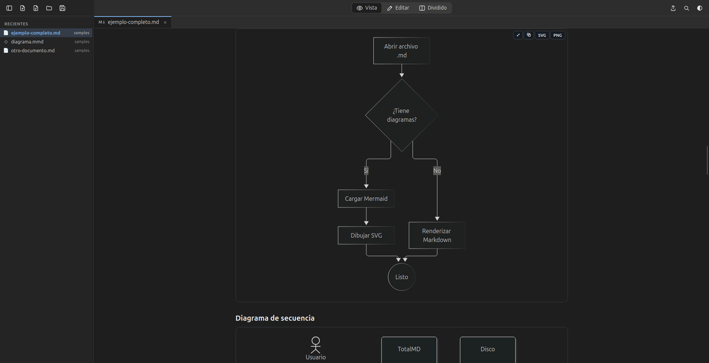
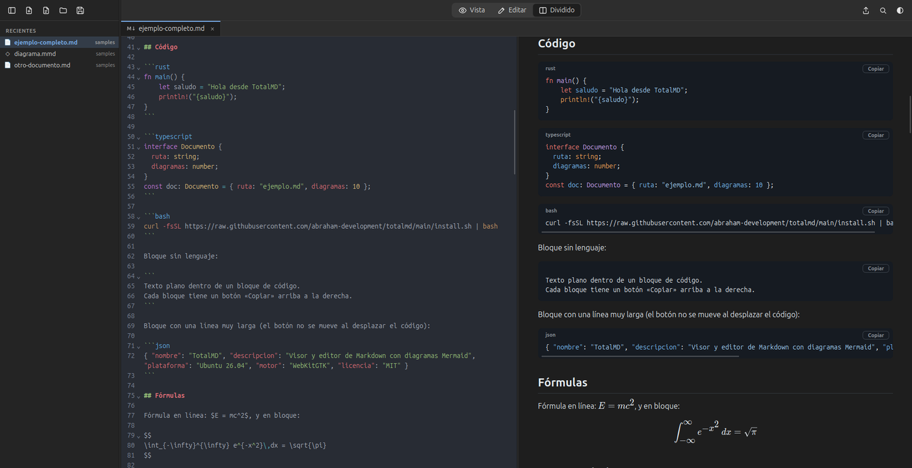
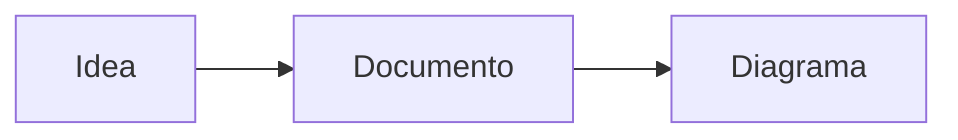

# TotalMD

**Visor y editor de documentos Markdown con diagramas Mermaid, para Ubuntu.**

Abre tus archivos `.md` y míralos tal como se ven en GitHub: con títulos, tablas, código, fórmulas y **diagramas Mermaid dibujados**. También abre archivos `.mmd` (diagramas sueltos) y te deja editarlos con la vista previa al lado.



## Instalar

Abre una terminal (`Ctrl+Alt+T`), pega este comando y pulsa Enter:

```bash
curl -fsSL https://raw.githubusercontent.com/abraham-development/totalmd/main/install.sh | bash
```

Te pedirá tu contraseña. Cuando termine, busca **TotalMD** en *Mostrar aplicaciones*.

Funciona en Ubuntu 26.04 y en sistemas parecidos (Debian, Linux Mint, Pop!_OS) con procesador de 64 bits (x86_64).

<details>
<summary>Instalar sin la terminal</summary>

1. Descarga [`TotalMD_amd64.deb`](https://github.com/abraham-development/totalmd/releases/latest/download/TotalMD_amd64.deb).
2. Haz doble clic en el archivo descargado, o en una terminal ejecuta `sudo apt install ./TotalMD_amd64.deb` desde la carpeta de descargas.
</details>

## Qué puedes hacer

- **Ver documentos Markdown** con tablas, listas de tareas, código con colores, fórmulas matemáticas, imágenes, notas al pie y emojis.
- **Ver diagramas Mermaid:** de flujo, de secuencia, de clases, de estados, Gantt, circulares, mapas mentales, líneas de tiempo… Tanto los que van dentro de un `.md` como los archivos `.mmd`.
- **Editar** con resaltado de sintaxis y ver el resultado al instante.
- **Copiar un bloque de código con un clic** con el botón «Copiar» de cada bloque.
- **Ampliar un diagrama** con doble clic, y exportarlo a SVG o PNG.
- **Trabajar con varios documentos** en pestañas, y abrir una carpeta entera en la barra lateral.
- **Exportar a PDF** en A4, con el mismo aspecto que en pantalla y compacto, para no gastar hojas de más al imprimirlo. También a HTML.
- **Tema claro u oscuro**, según el de Ubuntu o elegido a mano.



## Cómo se usa

### Abrir documentos
- Haz doble clic en un archivo `.md` o `.mmd`, o clic derecho → *Abrir con* → **TotalMD**.
- O arrástralo a la ventana de TotalMD.
- O usa los botones de arriba a la izquierda: **abrir archivo** (`Ctrl+O`) o **abrir carpeta** (`Ctrl+Mayús+O`). Al abrir una carpeta verás todos sus documentos en la barra lateral.

### Los tres modos
Arriba en el centro eliges cómo ver el documento:

| Modo | Para qué sirve | Atajo |
|---|---|---|
| **Vista** | Leer el documento ya formateado | `Ctrl+1` |
| **Editar** | Escribir el texto Markdown | `Ctrl+2` |
| **Dividido** | Editar y ver el resultado a la vez; los dos lados se desplazan juntos | `Ctrl+3` |

Guarda con `Ctrl+S`. Si cambias el archivo desde otro programa, TotalMD lo recarga solo.

### Escribir un diagrama
Dentro de un `.md`, escribe el diagrama en un bloque de código con la palabra `mermaid`:

````markdown

````

Si el diagrama tiene un error, TotalMD lo muestra en un recuadro rojo con el motivo, y abajo, en la barra de estado, avisa «⚠ 1 con error».

### Exportar a PDF e imprimir
En el menú de exportar (el icono ⇪ arriba a la derecha) elige **Exportar a PDF…** y dónde guardarlo. El PDF sale en tamaño A4 y siempre en colores claros, aunque uses el tema oscuro. La letra es compacta y los diagramas se ajustan a la página, sin que un título quede solo al final de una hoja.

Para imprimir directamente, usa **Imprimir…** en el mismo menú o pulsa `Ctrl+P`.

### Atajos de teclado

| Acción | Atajo |
|---|---|
| Nuevo / abrir / abrir carpeta | `Ctrl+N` / `Ctrl+O` / `Ctrl+Mayús+O` |
| Guardar / guardar como | `Ctrl+S` / `Ctrl+Mayús+S` |
| Cerrar pestaña / cambiar de pestaña | `Ctrl+W` / `Ctrl+Tab` |
| Vista / Editar / Dividido | `Ctrl+1` / `Ctrl+2` / `Ctrl+3` |
| Mostrar u ocultar la barra lateral | `Ctrl+B` |
| Buscar | `Ctrl+F` |
| Imprimir | `Ctrl+P` |
| Agrandar / reducir / tamaño normal | `Ctrl+=` / `Ctrl+-` / `Ctrl+0` |

## Actualizaciones

TotalMD se actualiza sola. Al abrirla, si hay una versión nueva, aparece una barra arriba con el botón **Actualizar**: pulsa, escribe tu contraseña y la app se reinicia ya actualizada.

La versión que tienes aparece abajo a la derecha («TotalMD v…»). Haz clic ahí para buscar actualizaciones en ese momento.

## Usar TotalMD para todos tus `.md`

Para que los `.md` y `.mmd` se abran siempre con TotalMD, abre el menú de exportar (el icono ⇪ arriba a la derecha) y elige **«Usar como app predeterminada para .md/.mmd»**.

## Desinstalar

```bash
curl -fsSL https://raw.githubusercontent.com/abraham-development/totalmd/main/install.sh | bash -s -- --uninstall
```

---

TotalMD es software libre bajo la [licencia MIT](LICENSE). Si quieres compilarla tú mismo, consulta [DESARROLLO.md](DESARROLLO.md).
