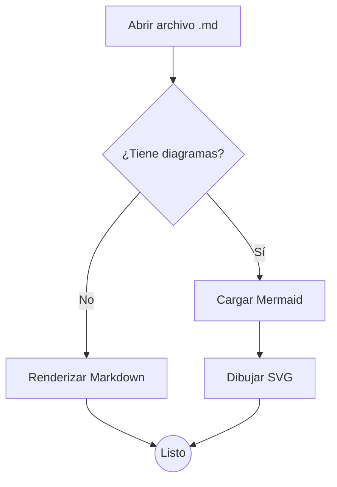
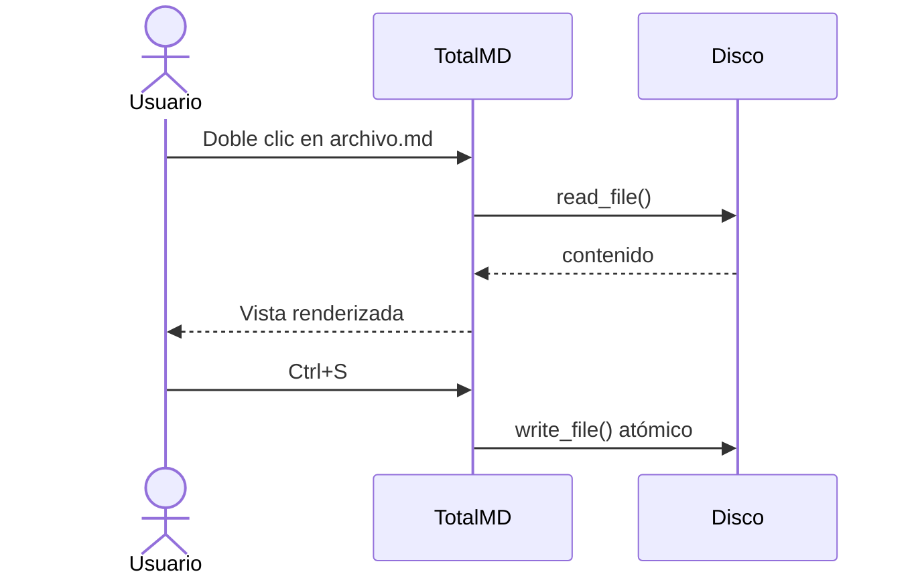
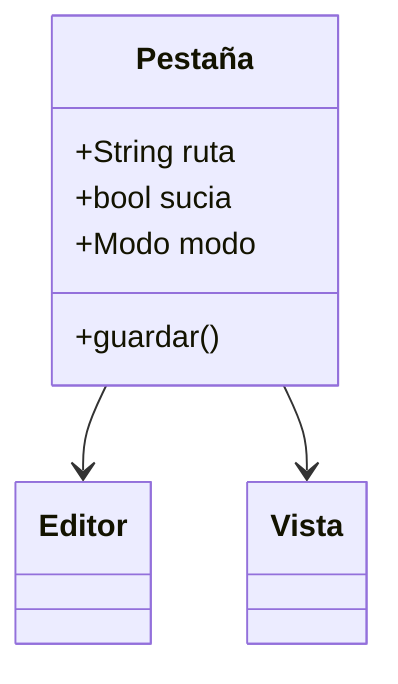
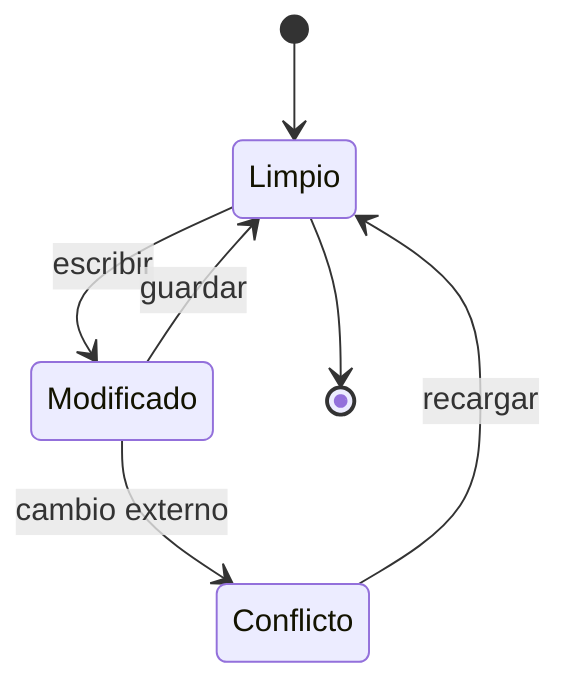
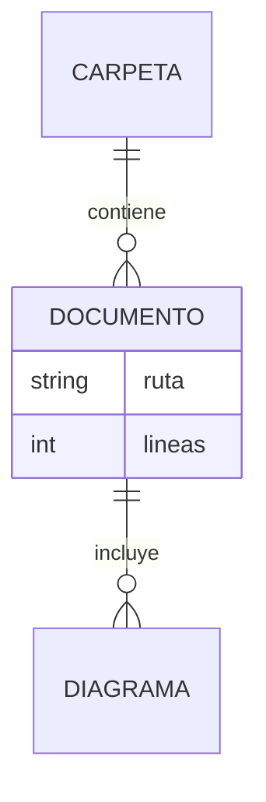
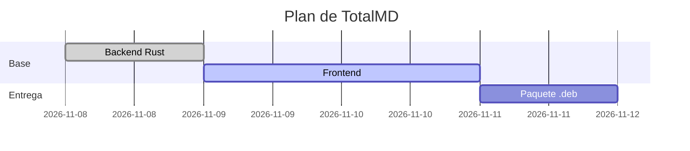
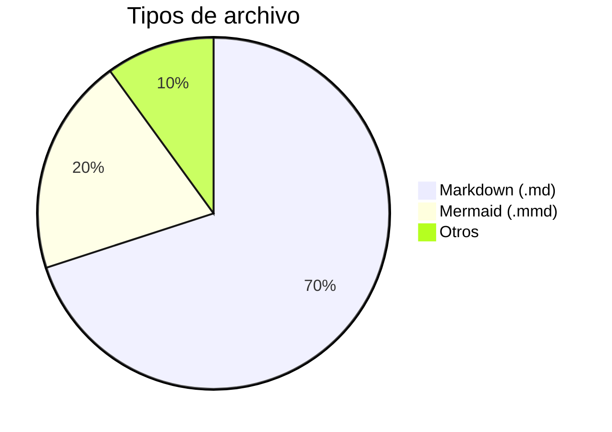
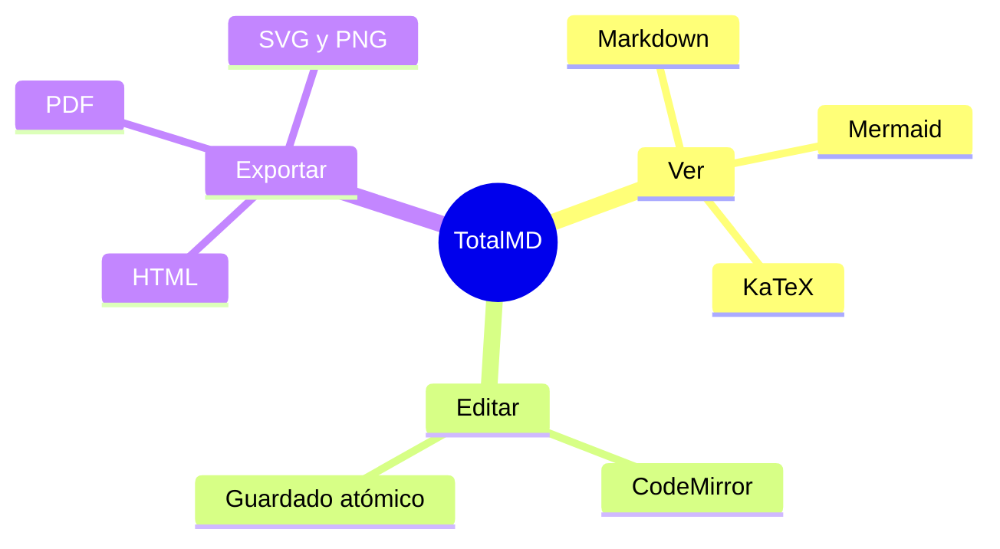
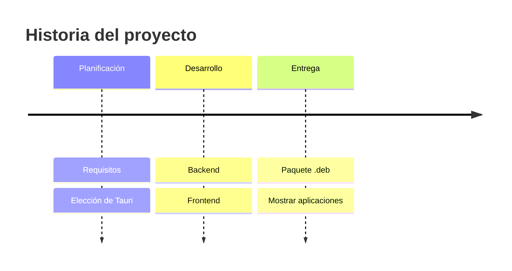
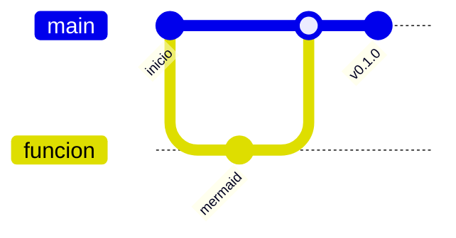

# Documento de ejemplo completo

Este archivo prueba **todo** lo que TotalMD sabe mostrar: texto con *cursiva*, **negrita**, ~~tachado~~, `código en línea`, enlaces como <https://mermaid.js.org> o [la documentación de Markdown](https://commonmark.org), emojis :rocket: :tada: y notas al pie[^1].

> **Consejo:** pulsa `Ctrl+3` para ver el editor y la vista lado a lado, `Ctrl+1` para solo la vista y `Ctrl+2` para solo el editor.

## Índice

1. [Tablas y listas](#tablas-y-listas)
2. [Código](#código)
3. [Fórmulas](#fórmulas)
4. [Diagramas Mermaid](#diagramas-mermaid)
5. [Otro documento](otro-documento.md)

## Tablas y listas

| Función            | Atajo         | Estado |
| :----------------- | :-----------: | -----: |
| Vista              | `Ctrl+1`      |     ✅ |
| Edición            | `Ctrl+2`      |     ✅ |
| Dividido           | `Ctrl+3`      |     ✅ |
| Imprimir           | `Ctrl+P`      |     ✅ |

- Lista con viñetas
  - Elemento anidado
    - Más anidado
- [x] Tarea completada (haz clic en la casilla en la vista)
- [ ] Tarea pendiente
- [ ] Otra tarea pendiente

1. Primero
2. Segundo
3. Tercero

## Código

```rust
fn main() {
    let saludo = "Hola desde TotalMD";
    println!("{saludo}");
}
```

```typescript
interface Documento {
  ruta: string;
  diagramas: number;
}
const doc: Documento = { ruta: "ejemplo.md", diagramas: 10 };
```

```bash
curl -fsSL https://raw.githubusercontent.com/abraham-development/totalmd/main/install.sh | bash
```

Bloque sin lenguaje:

```
Texto plano dentro de un bloque de código.
Cada bloque tiene un botón «Copiar» arriba a la derecha.
```

Bloque con una línea muy larga (el botón no se mueve al desplazar el código):

```json
{ "nombre": "TotalMD", "descripcion": "Visor y editor de Markdown con diagramas Mermaid", "plataforma": "Ubuntu 26.04", "motor": "WebKitGTK", "licencia": "MIT" }
```

## Fórmulas

Fórmula en línea: $E = mc^2$, y en bloque:

$$
\int_{-\infty}^{\infty} e^{-x^2}\,dx = \sqrt{\pi}
$$

## Imagen relativa


## Diagramas Mermaid

### Diagrama de flujo



### Diagrama de secuencia



### Diagrama de clases



### Diagrama de estados



### Entidad-relación



### Gantt



### Gráfico circular



### Mapa mental



### Línea de tiempo



### Git



### Bloque con extensión `mmd`

```mmd
graph LR
    md[.md] --> vista[Vista]
    mmd[.mmd] --> vista
```

### Diagrama con un error (a propósito)

Este bloque tiene un error de sintaxis: TotalMD debe mostrar el mensaje sin romperse.

```mermaid
flowchart TD
    A --> B -->
    esto no es válido ((
```

---

[^1]: Las notas al pie aparecen al final del documento.
